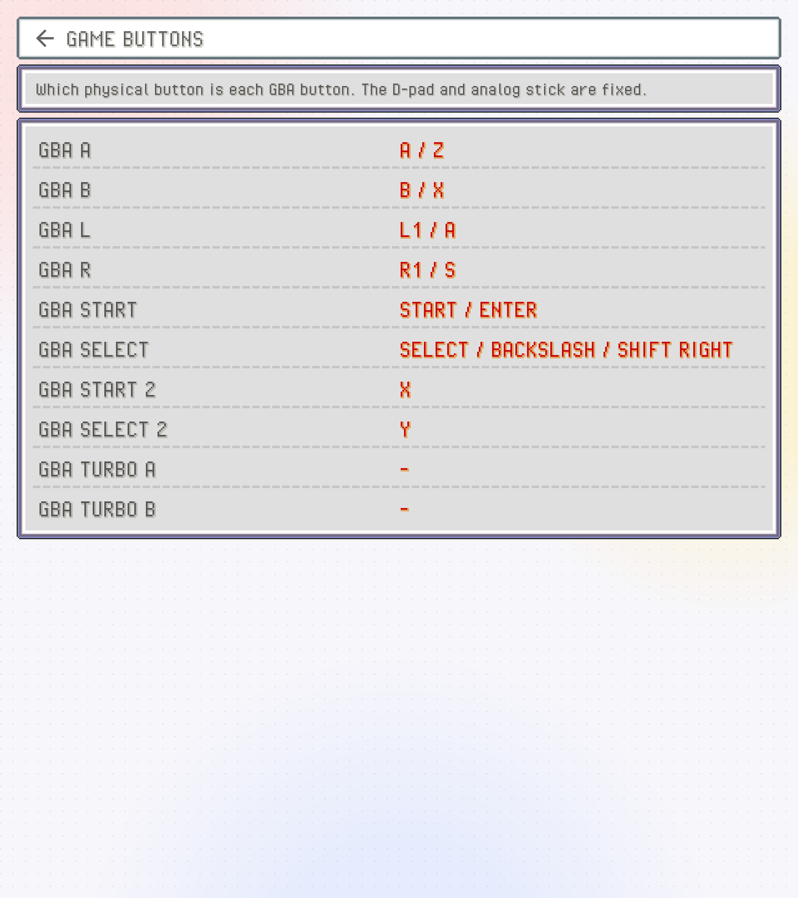
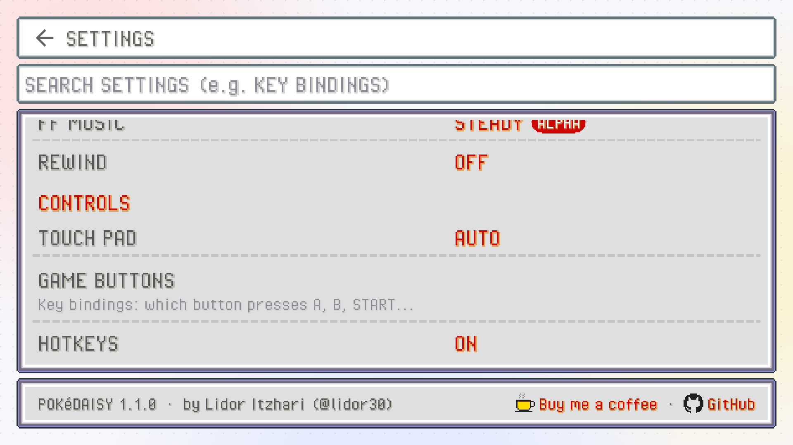
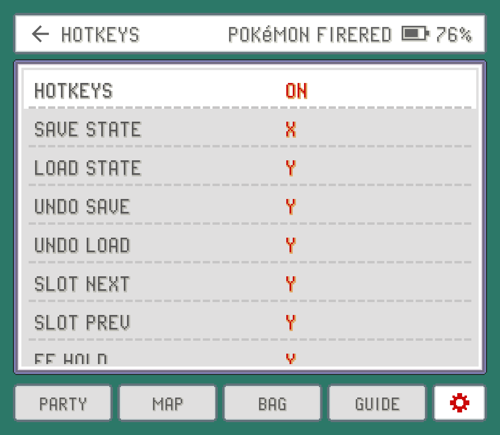

PokeDaisy works out of the box on handhelds like the AYN Thor: the face buttons, shoulders, START and SELECT are the GBA's, and a few button combinations do emulator things like saving a state. Everything here is about changing that: which button presses what, which shortcuts exist, and what happens when you plug in a controller or play by touch.

All of it lives in the `CONTROLS` group, on both screens: the top screen's Settings (from the library) and the companion's `SETTINGS`.

## Game buttons

`GAME BUTTONS` sets which physical button presses each GBA button. Open it and you'll see a row per GBA button with the keys it's on now.

| GBA button | Default |
| --- | --- |
| `GBA A` and `GBA B` | A and B |
| `GBA L` and `GBA R` | L1 and R1 |
| `GBA START` and `GBA SELECT` | START and SELECT |
| `GBA START 2` and `GBA SELECT 2` | X and Y |
| `GBA TURBO A` and `GBA TURBO B` | Nothing |

`START 2` and `SELECT 2` are a second START and SELECT, so X opens the menu and Y uses your registered item, like in the DS games. Each GBA button also has a keyboard key (Z, X, A, S, Enter and so on) for when you play with one.

To change one:

- **On the top screen**, tap the row (it says `PRESS A BUTTON…`) and press the button you want.
- **On the companion**, tap the row and pick the button's name from the list. The bottom screen doesn't receive button presses, which is why it asks you to choose from a list.

The new button replaces everything that GBA button had, keyboard key included. A button can only do one GBA button: put it on a new one and it leaves the old one.

> [!NOTE]
> Buttons go by Android's names, which follow an Xbox controller's layout. On AYN and Retroid devices, `A` is the bottom face button even where the printed label says something else. If A and B feel swapped, swap them here.

The D-pad and the analog stick always move; they can't be remapped. First-time setup has a page listing these buttons too, with `CHANGE BUTTONS` to jump straight here.

## Turbo A and B

`TURBO A` and `TURBO B` press A or B over and over for as long as you hold them. They're good for mashing through text, or for anything that wants you to hammer a button. They aren't on any button until you put them on one in `GAME BUTTONS`.

Turbo counts in game time, so with fast-forward on it mashes faster along with the game. It pauses while the companion's battle buttons are pressing the game's buttons for you.

## Hotkeys

Hotkeys are shortcuts for things outside the game: save states, fast-forward, leaving the game. A hotkey can be one button or a **chord**, several buttons pressed together. SELECT + R1 is a chord: the second button fires it while the first is held.

Chords don't take a button away from the game. SELECT alone still works in game; only SELECT + R1 together saves a state.

| Hotkey | What it does | Controller | Keyboard |
| --- | --- | --- | --- |
| `SAVE STATE` | Saves a state in the current slot | SELECT + R1 | F1 |
| `LOAD STATE` | Loads the current slot's state | SELECT + L1 | F2 |
| `UNDO SAVE` | Puts back the state your last save replaced | | F3 |
| `UNDO LOAD` | Returns to where you were before your last load | | F4 |
| `SLOT NEXT` | Next save state slot | | ] |
| `SLOT PREV` | Previous save state slot | L3 (shown as `THUMBL`) | [ |
| `FF HOLD` | Fast-forward while held | R2 | Space |
| `FF TOGGLE` | Fast-forward on or off | | Tab |
| `SPEED CYCLE` | Steps the game speed through 1x, 1.5x, 2x, 3x and 4x | L2 | = |
| `SLOWMO HOLD` | Half speed while held | | minus |
| `REWIND HOLD` | Plays the last moments backwards (needs `REWIND` on) | | R |
| `ZOOM` | Steps the zoom (needs `ASPECT` set to `EXPAND`) | R3 (shown as `THUMBR`) | C |
| `EXIT GAME` | Leaves the game, back to the library | SELECT + START | Esc |

The speed hotkeys are explained in [Fast-forward and game speed](fast-forward.md), states and rewind in [Saves](saves.md), and zoom in [Screen](screen.md).

### Changing a hotkey

**On the top screen** (Settings > `HOTKEYS`), tap a hotkey; it says `PRESS KEYS…`. Press one button, or hold several together and release, to set it. A chord can only be set up here. While a hotkey waits for keys:

- `CLEAR` leaves it with no button at all (it shows `-`).
- `CANCEL`, or `BACK`, keeps it as it was.

**On the companion** (`SETTINGS` > `HOTKEYS`), tap a hotkey and pick one button from the list. Pick `NONE` to unbind it. The companion sets single buttons only: for a chord, use the top screen.

Either way, the new buttons replace the hotkey's whole binding, keyboard key included.

### When a button is already taken

If you pick exactly the buttons another hotkey already has (the same buttons in any order), you get `KEY IN USE`. Tap `MOVE` to take them from the other hotkey, or cancel to leave both as they were. Sharing only some buttons is fine: SELECT + R1 and SELECT + L1 can both exist, that's how chords work.

### Turning hotkeys off

The `HOTKEYS` switch at the top of the page turns every hotkey off at once. The bindings stay as they are (greyed out) and every button goes straight to the game. It's handy if a game needs a combination that clashes with a hotkey, and you'd rather not rebind anything.

## Touch pad

`TOUCH PAD` puts on-screen controls over the game, for when you have no buttons:

- **`AUTO`** (the default) shows them only when no controller is connected, and hides them as soon as you press a real button.
- **`ALWAYS`** keeps them on screen.
- **`NEVER`** never shows them.

A change takes effect the next time you open a game. On a phone held upright the touch controls sit between the game and the companion when there's room; see [Devices](devices.md).

## External controllers

Bluetooth and USB controllers (8BitDo, GameSir, Xbox and so on) work, and you can connect one while a game is running without restarting it. A short message on the game screen says when a controller connects or goes away. Its buttons follow `GAME BUTTONS` and `HOTKEYS` like the built-in ones, and diagonals on its D-pad press both directions.

A controller's HOME or guide button, unless you've bound it to something, works like a tap of `BACK` (see below).

> [!NOTE]
> External controllers haven't been tested widely yet. If one doesn't behave, please report it with the controller's name.

## Analog L2 and R2

Some handhelds and controllers (Retroid's, for example) send their L2 and R2 triggers as analog values rather than button presses. PokeDaisy treats a trigger pulled past half way as a press of L2 or R2. That means the triggers follow your settings like any other button: by default R2 is `FF HOLD` and L2 is `SPEED CYCLE`, they stop when `HOTKEYS` is off, and you can bind them to anything, including GBA buttons. Hotkeys get first go at them, then the game.

## The BACK button

`BACK` does two different things depending on how long you press it:

- **A tap** is the companion's back. It closes whatever is open on the companion (a pick-list, a Pokémon's summary, a sub-page of `SETTINGS`) and steps back from there. With nothing left to close it does nothing, so you can't leave a game by accident. If you closed the companion with `CLOSE COMPANION`, a tap brings it back.
- **A hold** leaves the game and returns to the library (or to the frontend that launched it).

This works from either screen. On a device with one screen, a tap also slides the companion panel in and out; see [Devices](devices.md).
