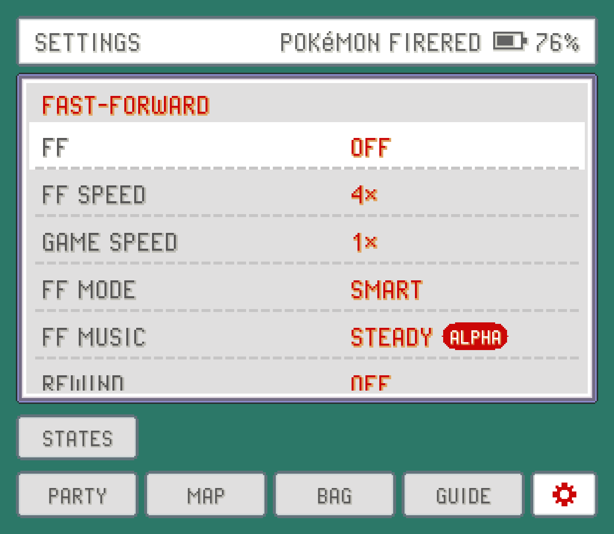
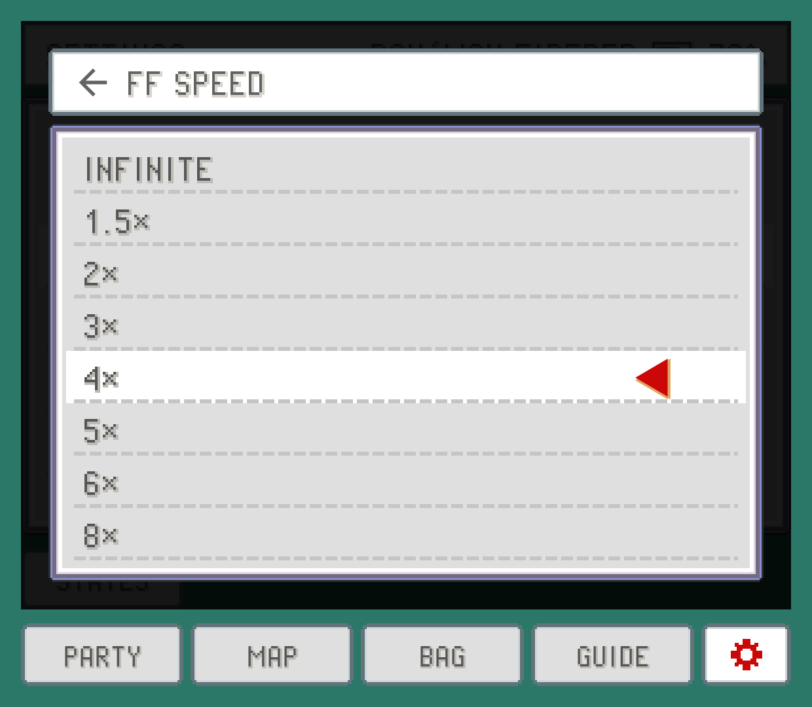

Pokémon games have a lot of walking, text and grinding. Fast-forward runs the game several times faster so you get through it quicker, and PokeDaisy tries to get out of your way when speed would be a problem: in menus, on the map, and with the music.

You'll find all the speed settings under `FAST-FORWARD` at the top of the companion's `SETTINGS`. Most of them are on the top screen's Settings too.

## Turning fast-forward on

There are three ways, and you can mix them:

- **The `FF` row** in the companion's `SETTINGS`: tap it to switch fast-forward `ON` or `OFF`. It stays the way you left it, even after you close the app.
- **`FF TOGGLE`**, a hotkey that does the same thing. It's on the Tab key of a keyboard by default; you can put it on a controller button under `HOTKEYS`.
- **`FF HOLD`**, a hotkey that fast-forwards only while you hold it: R2 on a controller, or the space bar. Let go and you're back to normal speed.

A short message on the game screen tells you what speed you're at whenever it changes. See [Controls, hotkeys and touch](controls.md) to change these buttons.

## How fast: FF SPEED

`FF SPEED` sets how fast fast-forward goes: `1.5×`, `2×` (the default), `3×`, `4×`, `5×`, `6×`, `8×` or `10×`. `INFINITE` takes the cap off and runs as fast as your device can manage.

Higher isn't always better. At 8x or 10x, text flies past before you can read it, and some devices get warm. 2x to 4x is a good everyday range.

## Smart or normal: FF MODE

Fast-forward is great for walking around and terrible for scrolling through a menu, where the cursor flies past what you wanted. `FF MODE` picks how that's handled:

- **`SMART`** (the default) drops to normal speed while a menu screen is open: your party, the bag, a Pokémon's summary, the PC, the Pokédex and the like. It does the same on the game's region map screens (including the one you pick a place to fly to) in FireRed, LeafGreen, Emerald and the hacks built on FireRed, so you can move the cursor. Close it and fast-forward picks up again by itself; you never have to turn it back on.
- **`NORMAL`** keeps fast-forward on everywhere.

A few things stay fast in `SMART` on purpose:

- **Battles.** The battle itself stays fast. Only the bag and party screens inside a battle slow down.
- **Shops.** The shop's buy and sell screens stay fast, since the clerk's lines are part of them and would crawl at normal speed.
- **The START menu and talking to people** stay fast too; they aren't menu screens.

## A pace that sticks: GAME SPEED

`GAME SPEED` (companion `SETTINGS` only) changes the game's normal speed rather than turning on fast-forward. Pick `0.25×`, `0.5×`, `1×`, `1.5×`, `2×`, `3×` or `4×`.

It's saved for each game separately. Set a hack you're replaying to `1.5×` and it opens at 1.5x every time, while your other games stay at 1x. Below 1x the sound is muted. If fast-forward is on, it wins over `GAME SPEED`; turn fast-forward off and you're back at your game speed.

The `SPEED CYCLE` hotkey (L2 on a controller, or the = key) steps through `1×`, `1.5×`, `2×`, `3×` and `4×` and round again, without opening `SETTINGS`. If you're on one of the slow speeds, it goes back to `1×`. Where it stops is saved for that game too.

## Slow motion

Hold the `SLOWMO HOLD` hotkey and the game runs at half speed until you let go, with the sound muted. It's handy for a tricky moment, like timing a button press or watching an animation you'd otherwise miss. On a keyboard it's the minus key; it has no controller button by default, so give it one under `HOTKEYS` if you want it.

For a slow pace that lasts, use `GAME SPEED` at `0.5×` or `0.25×` instead.

## Music while fast-forwarding: FF MUSIC

Sped-up game music turns into chipmunk noise. `FF MUSIC` picks what you hear while fast-forwarding:

- **`STEADY`** (marked `ALPHA`, the default) keeps the song playing at its normal speed and pitch while the game races. The song loops where the game loops it, and it carries on through menus when `SMART` slows the game down, instead of starting over.
- **`SPED-UP`** plays the game's own sound at the game's speed.
- **`OFF`** is silence while fast-forwarding.

`STEADY` works by preparing a clean recording of each song from your ROM, in the background. The first time you play a game, it goes through the game's songs once; a song that isn't ready yet is silent during fast-forward. Once a song is done, it's kept, so this only happens the first time you hear it.

> [!NOTE]
> `STEADY` is still an alpha. If a song sounds wrong or stays silent, switch to `SPED-UP`, and let us know which game and where.

## The real-time clock

Ruby, Sapphire, Emerald and the Pokémon hacks that use a clock get it from your device. Day and night, berries growing, tides and daily events follow the device's date and time, with nothing to set up. Save files and save states keep the clock, so it carries on correctly.

The clock follows real time, not game speed: fast-forward doesn't make berries grow faster.

## Rewind

Missed a jump or walked into the wrong trainer? With `REWIND` on, holding the `REWIND HOLD` hotkey plays the last 20 seconds or so backwards. It's off by default and never touches your save file. See [Saves](saves.md) for how it works.
